# PocketDeck-OS for the Xteink X3, with the Collins COBUILD English–Kannada dictionary

**PocketDeck-OS** turns a pocket e-ink reader into a complete daily companion: a
fast, distraction-free book reader, a Kannada-literate dictionary, and a deck of
productivity and wellbeing tools, all running offline on a tiny ESP32 with a
week-long battery. No phone, no cloud, no account: everything lives on your SD
card.

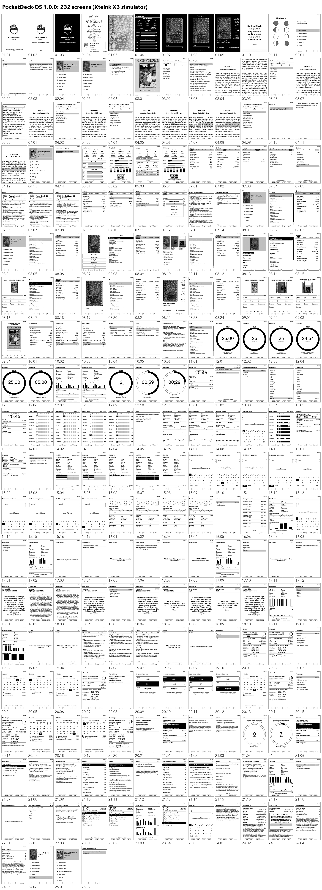

## Why PocketDeck-OS

- **A reader that gets out of the way.** EPUB, TXT and XTC books with bundled
  and SD-card fonts, bookmarks, clippings, footnotes, focus reading, tilt page
  turn and per-book settings.
- **Kannada everywhere.** Properly shaped Kannada in books, in your own files,
  in the tools and now inside dictionary definitions, drawn on the device from
  a font on the SD card. Japanese, Chinese, Korean, Russian and Spanish books
  read just as well.
- **A real English–Kannada dictionary.** Look up any word while reading and see
  the Collins COBUILD definition with Kannada equivalents, meanings and example
  translations underneath (details below).
- **A full toolkit in your pocket.** Panchanga (Kannada or English, 1976–2075,
  with Karnataka festivals), Mantras with a japa counter, Today to-do list,
  Pomodoro, Habit Tracker, Medicine, Mood, Flashcards with spaced repetition,
  Daily Quote, Knowledge cards, Workout (yoga and pranayama) and World Clock.
- **Reading statistics that motivate.** Streaks, per-book stats, a library
  dashboard and a monthly export to `/stats`.
- **Make it yours.** Eight themes (PocketDeck, Classic, Lyra, Lyra Extended,
  RoundedRaff, Lyra Carousel, Minimal, Dashboard), sleep screens with your own
  rotating wallpapers.
- **Connected when you want it.** WiFi file transfer from any browser, OPDS
  catalogues and KOReader sync.
- **Your content, your files.** Quotes, flashcards, knowledge, mantras and
  festivals are plain text and JSON that you edit in any editor.
- **Safe to try.** Installs over CrossInk from the SD card in about a minute and
  keeps every book, bookmark, stat and setting.

| 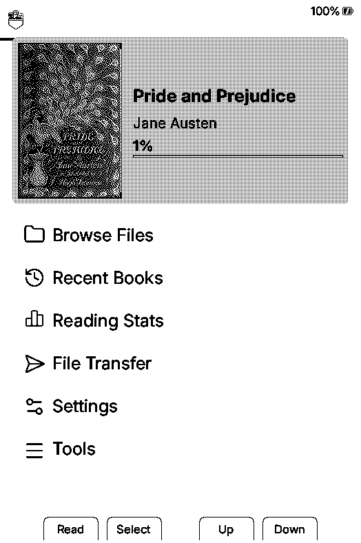 | 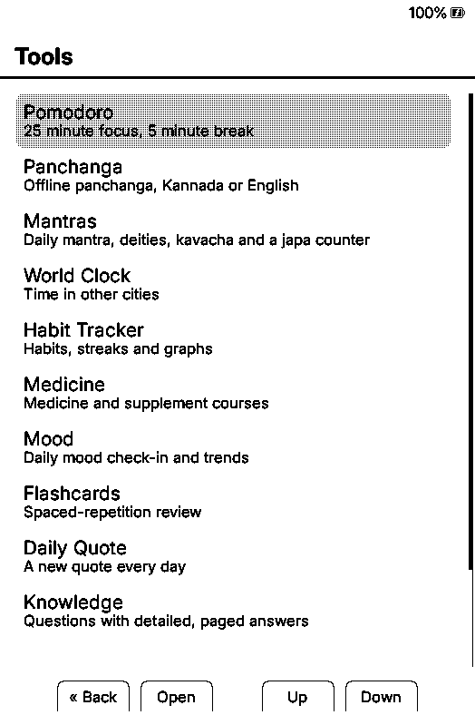 | 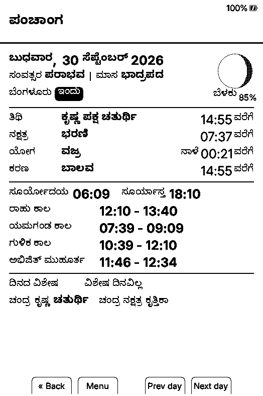 | 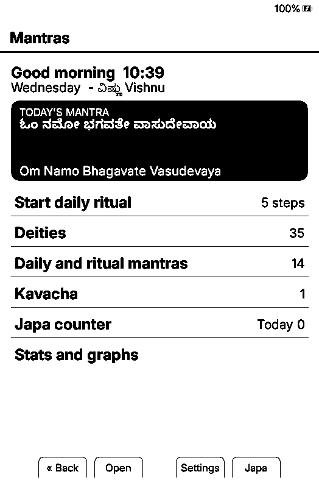 |
|---|---|---|---|
| Home (PocketDeck theme) | Tools | Panchanga in Kannada | Mantras and japa |

| 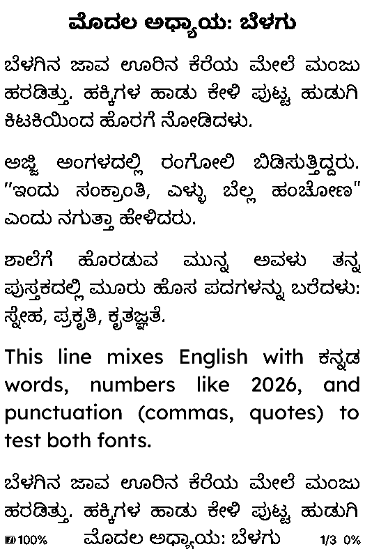 | 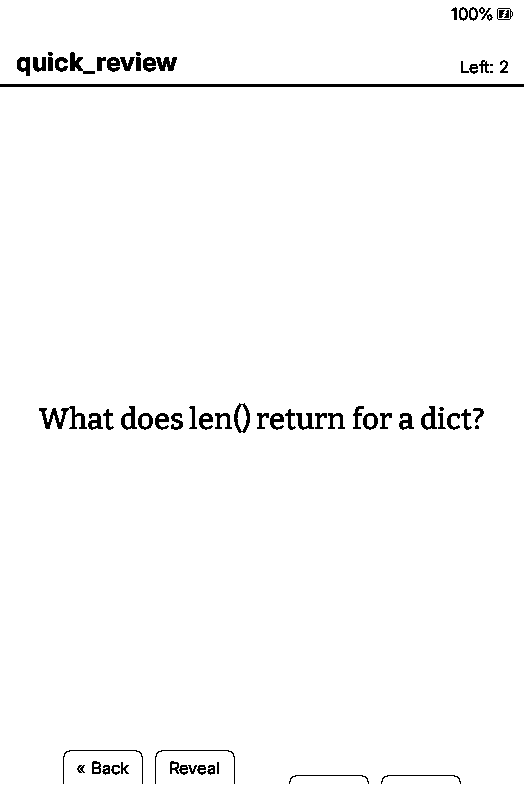 | 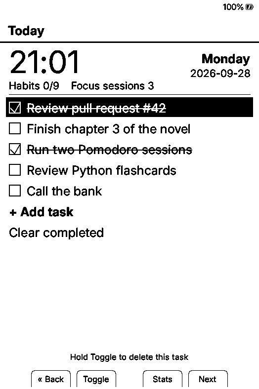 | 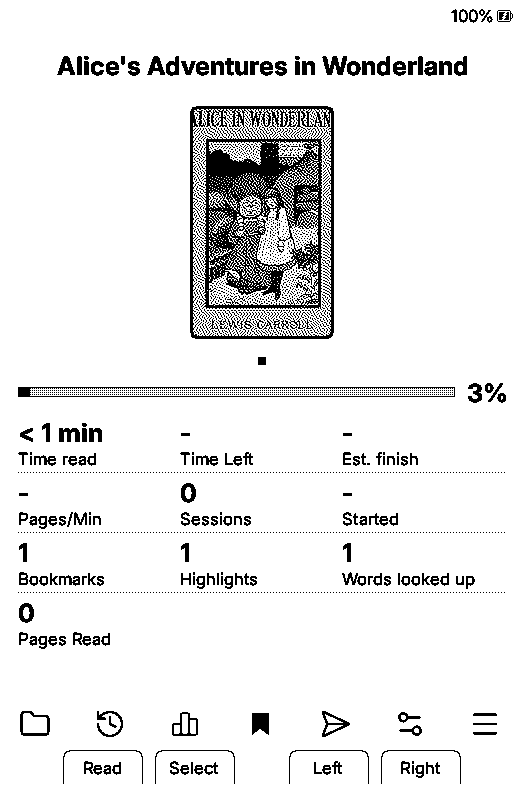 |
|---|---|---|---|
| A Kannada book | Flashcards | Today | Book stats carousel |

Every screen is in the [screenshot walkthrough](docs/screenshots/README.md).

## Collins COBUILD English–Kannada dictionary

The Collins COBUILD Advanced Learner's Dictionary (34,159 headwords) with
Kannada added to every entry:

| Added | Where | Example |
|---|---|---|
| Kannada equivalents | under the headword | `ಕನ್ನಡ: ಬಿಡು, ತ್ಯಜಿಸು` |
| Each meaning in Kannada | under the English meaning | `ಅರ್ಥ: ನೀವು ಒಂದು ಸ್ಥಳವನ್ನು ತ್ಯಜಿಸಿದರೆ…` |
| Each example sentence in Kannada | under the English example | `ತನ್ನ ಹೆತ್ತವರು ತನ್ನನ್ನು ತೊರೆದಿದ್ದಾರೆ ಎಂದು…` |

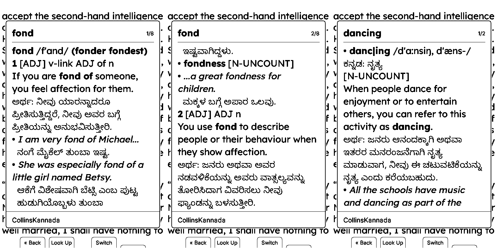

*"fond" (pages 1 and 2) and "dancing", looked up from a book on the X3.*

The English Collins text is unchanged. A plain headword was also added for each of
the 101 words that Collins splits into numbered entries (`be(1)`, `be(2)`…), so
looking up "be" or "certain" opens the definition directly.

## Install

Step-by-step instructions with screenshots are in
**[INSTALLATION_GUIDE.md](INSTALLATION_GUIDE.md)**. In short:

1. **Firmware.** Copy `firmware/pocketdeck-os-x3.bin` (same file as
   `dist/pocketdeck-os-x3.bin`) to the SD card, then on the reader choose
   **Settings > System > SD Card Firmware Update** and select it. This build
   draws Kannada in dictionary entries; older builds show Kannada only in
   books and the tools.
2. **Kannada font.** Copy `sd-sample/tools/fonts/kannada.knf` to
   `/tools/fonts/kannada.knf` on the SD card (it is already there if Panchanga
   shows Kannada).
3. **Dictionary.** Copy `sd-sample/dictionaries/CollinsKannada` (or unzip
   `CollinsKannada.zip`) into `/dictionaries/` (or `/.dictionaries/`) on the SD
   card, so you have `/dictionaries/CollinsKannada/CollinsKannada.idx` and the
   other seven files.
4. On the reader, choose **CollinsKannada** in **Settings > Reader > Dictionary**.

The dictionary is recognised as English–Kannada by `lang=en-kn` in its `.ifo`.

| 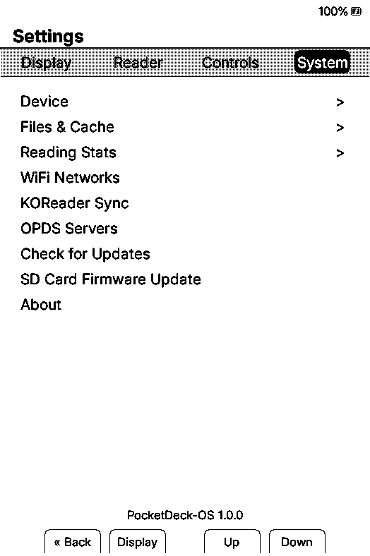 | 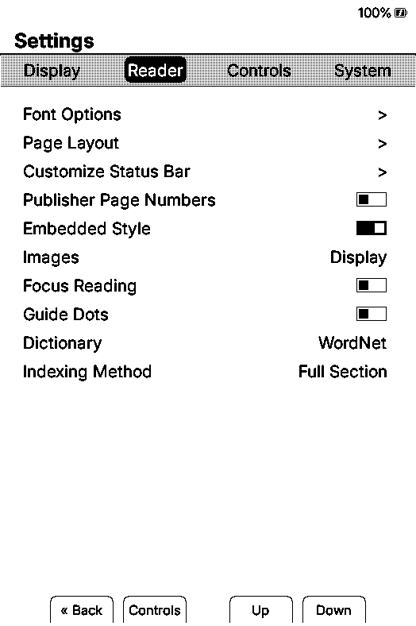 | 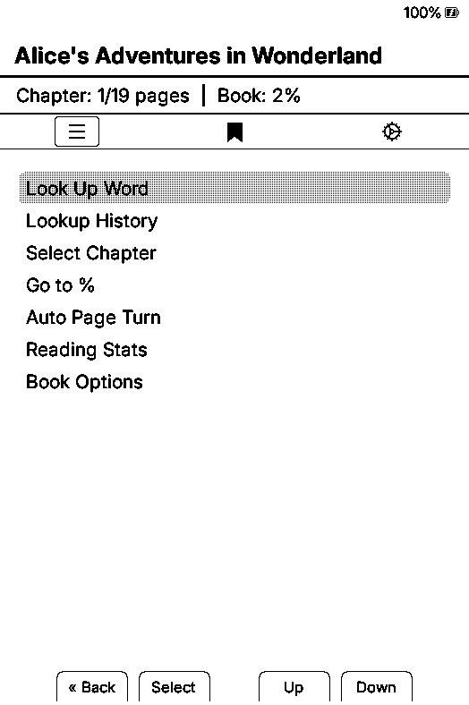 | 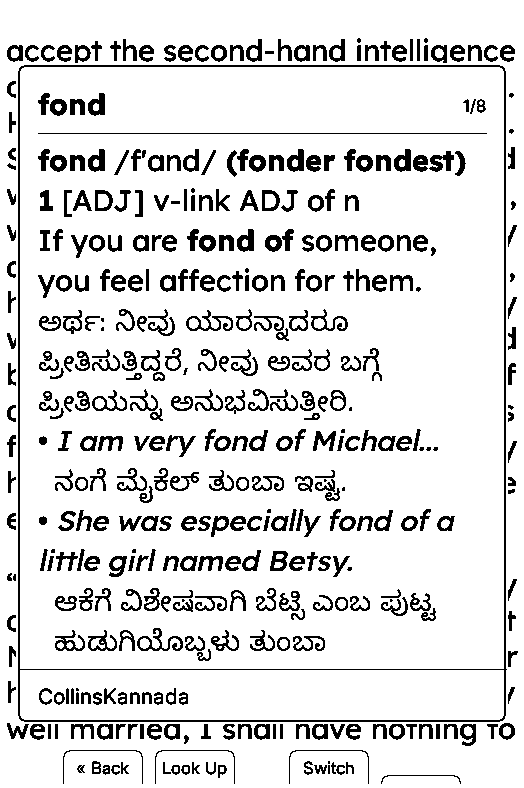 |
|---|---|---|---|
| Firmware update | Choose the dictionary | Look Up Word | English and Kannada |

## Memory

- Firmware image: 6,419,040 bytes, fits the 6,553,600-byte X3 app partition with
  134,560 bytes free (the dictionary change adds under 1 KB). Static RAM is unchanged
  (64,392 of 327,680 bytes).
- At run time the Kannada font takes about 20 KB of heap while a definition is
  open. It is opened only for an English–Kannada dictionary and only when at least
  40 KB is free (24 KB contiguous); otherwise the entry is shown without Kannada
  shaping rather than risking a crash. Closing the definition frees it.
- The dictionary files themselves live on the SD card; the device reads one page
  of a definition at a time.

## How the Kannada was made (and its limits)

- Meanings and examples: machine translated with **IndicTrans2** (AI4Bharat),
  run locally. Every string was translated with the 200M model; the most common
  words were translated again with the larger 1B model, and where the two
  differ, both Kannada versions were translated back into English and the one
  closer to the Collins English was kept. Machine translation is usually right
  but can be literal or awkward, especially for idioms and grammar notes.
- Equivalents: the headword translated on its own, kept only when the
  translations of that word's own meanings and examples use the same Kannada
  word (this drops wrong senses and mere spellings of the English word), plus
  words from the **Alar** Kannada–English dictionary by V. Krishna (ODC-ODbL)
  that pass the same check.
- `CollinsKannada-200M.zip` is the first complete build (200M model only), kept
  for comparison.
- Display: every distinct Kannada word was checked against HarfBuzz using the
  device's own syllable algorithm; see `shaping-report.txt`.
- Collins COBUILD is © HarperCollins Publishers; keep this file for personal use.

## Rebuilding

`tools/` holds the scripts: `extract.py` (strings to translate), `translate.py`
(IndicTrans2, resumable), `heads.py` + `glosses.py` (equivalents), `build_dict.py`
(StarDict output), `dictionary_tools.py prep` (`.oft`/`.cspt` indexes, from
CrossInk/PocketDeck-OS) and `verify_shaping.py`. `finish.sh` runs the last steps.

## Credits

PocketDeck-OS is built on **CrossInk** and the **CrossPoint**
reader firmware it grew from; thank you to both projects and their
contributors.
